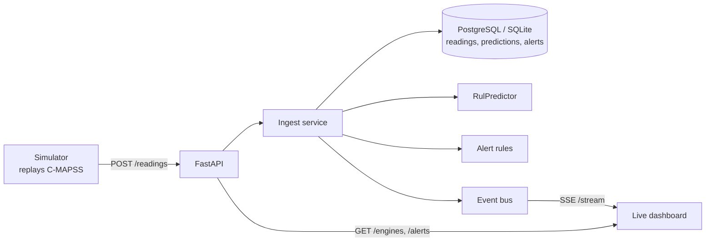

# EngineWatch

[](https://github.com/YOUR_USERNAME/enginewatch/actions/workflows/ci.yml)

A predictive-maintenance platform for turbofan engine fleets. Sensor readings stream in over HTTP,
a Remaining-Useful-Life (RUL) model scores each one, an alert engine escalates degrading engines,
and a live dashboard shows the fleet in real time. It runs on NASA's C-MAPSS dataset, replayed
cycle by cycle as if the engines were operating right now.

The focus is the **software system around the model**: API design, data modelling, streaming,
alerting semantics, testing and deployment. The model is a small, swappable baseline.

## Architecture



Request flow for `POST /readings`:

1. Reject duplicates (`409`) and malformed payloads (`422`).
2. Persist the raw reading.
3. Load the engine's last *N* readings and compute features with the **same function used in
   training**, so there is no train/serve skew.
4. Store the RUL prediction and evaluate alert rules.
5. Commit, then publish `reading` / `alert` events to connected dashboards over Server-Sent Events.

## Quickstart

```bash
python -m venv .venv && source .venv/bin/activate
pip install -e ".[dev]"

enginewatch train --synthetic        # or: --data-dir data/CMAPSS --subset FD001
enginewatch serve                    # http://127.0.0.1:8000 (dashboard), /docs (OpenAPI)

# in a second terminal
enginewatch simulate --synthetic --units 5 --rate 25
```

With Docker (PostgreSQL + API + simulator):

```bash
enginewatch train --synthetic        # the API container mounts ./models read-only
docker compose --profile demo up --build
```

Using the real dataset: see [`data/README.md`](data/README.md).

## API

| Method | Path | Description |
| ------ | ---- | ----------- |
| `POST` | `/readings` | Ingest one reading; returns RUL, status and any alerts raised |
| `GET`  | `/engines` | Fleet overview: latest cycle, RUL and status per engine |
| `GET`  | `/engines/{id}/history` | RUL estimate per cycle for one engine |
| `GET`  | `/alerts` | Recent alerts (`?engine_id=`, `?limit=`) |
| `GET`  | `/stream` | Server-Sent Events: live `reading` and `alert` events |
| `GET`  | `/health` | Liveness + whether a model is loaded |

Example body for `POST /readings`:

```json
{
  "engine_id": 1,
  "cycle": 42,
  "settings": [-0.0007, -0.0004, 100.0],
  "sensors": {"s2": 641.8, "s3": 1589.7, "s4": 1400.6, "...": 0.0}
}
```

## Design decisions

- **Alerts latch per engine.** An alert fires only when severity exceeds the highest level already
  raised for that engine. My first version compared against the previous prediction, and a test
  caught it raising "critical" twice when noisy RUL estimates jittered around the threshold.
- **Shared feature code** for training and serving (`ml/features.py`), with a test asserting the
  online path matches the offline path exactly.
- **The system works without a model.** If no model file is present, readings are still stored and
  RUL is `null` (status `unknown`), so ingest does not depend on ML availability.
- **SQLite by default, PostgreSQL in Docker.** One SQLAlchemy codebase, selected via
  `EW_DATABASE_URL`.
- **Thread-safe event bus.** Sync endpoints run in a thread pool while SSE subscribers live on the
  event loop, so publishing uses `call_soon_threadsafe` and drops events for slow consumers rather
  than blocking ingest.
- **Synthetic data generator** with the C-MAPSS schema keeps tests and CI independent of a dataset
  download.

## Configuration

Environment variables (prefix `EW_`, see `.env.example`):

| Variable | Default | Meaning |
| -------- | ------- | ------- |
| `EW_DATABASE_URL` | `sqlite:///./enginewatch.db` | SQLAlchemy URL |
| `EW_RUL_MODEL_PATH` | `models/rul_baseline.joblib` | Trained model file |
| `EW_WARNING_RUL` | `60` | RUL (cycles) at or below which status is `warning` |
| `EW_CRITICAL_RUL` | `30` | RUL (cycles) at or below which status is `critical` |

## Development

```bash
make test     # pytest
make lint     # ruff check + format check
```

## Roadmap

- [ ] Alembic migrations instead of `create_all`
- [ ] Batch ingest endpoint (`POST /readings/batch`)
- [ ] API-key authentication and per-fleet tenancy
- [ ] Prometheus metrics (ingest latency, alert counts, prediction latency)
- [ ] TimescaleDB hypertables for readings
- [ ] Model registry + hot-reload of the RUL model without restart
- [ ] Sensor drift detection on incoming data
- [ ] Alert delivery channels (webhook, email) with acknowledgement state
- [ ] Frontend: per-engine sensor charts

## License

MIT
